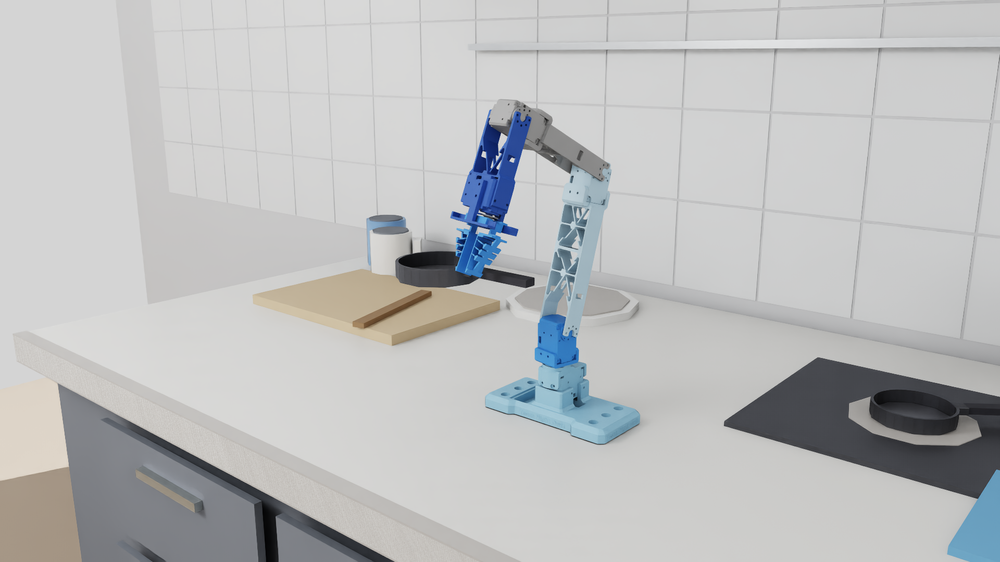
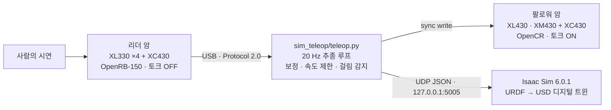
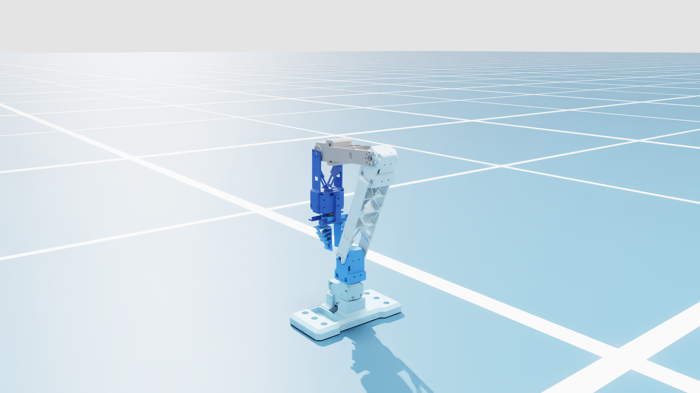
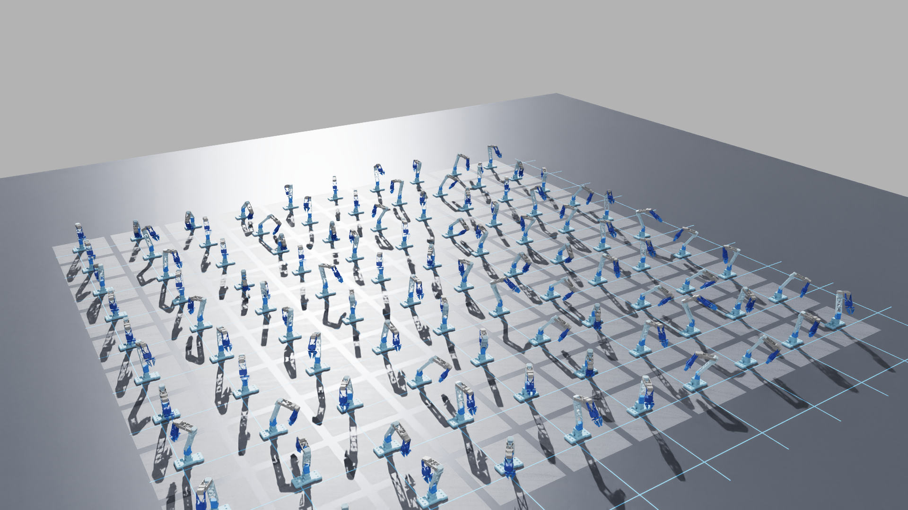
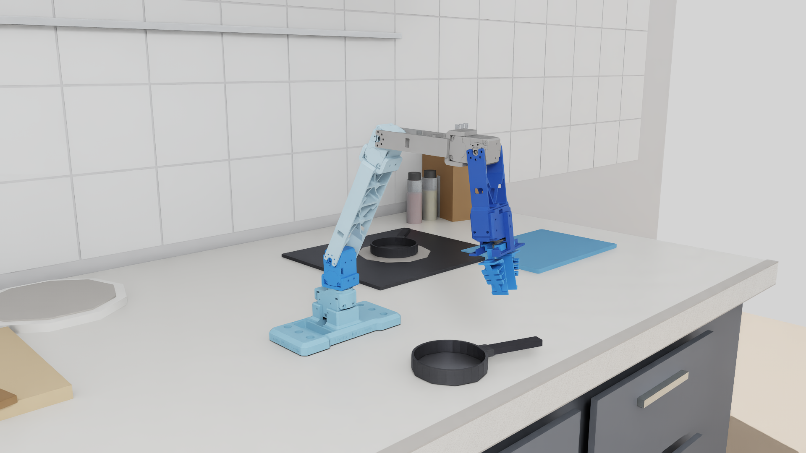
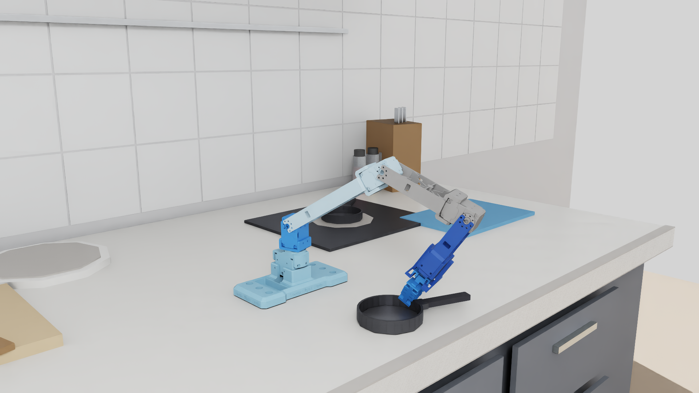
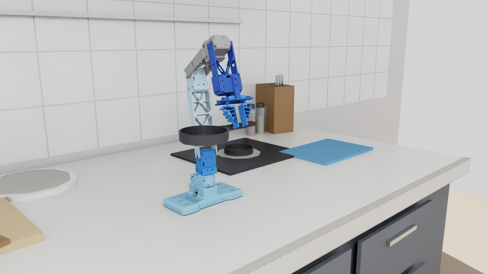

# 키친모션 (Kitchen Motion) · Kitchen4D

> 소상공인 주방의 반복 작업을 위한 **4자유도 양팔 로봇**과,
> 사람의 시연을 실시간으로 따라 하는 **리더-팔로워 텔레오퍼레이션 + Isaac Sim 디지털 트윈** 검증 플랫폼



- 2026 YU 창의적 종합설계 경진대회 · 2026 대구경북 KOVA 캡스톤디자인 경진대회 출품 (팀 Kitchen4D)
- 영남대학교 로봇공학과 · 전성빈(팀장) · 이규홍 · 박종진

## 한눈에 보기

| 항목 | 내용 |
|---|---|
| 문제 | 조리 자동화 연구는 다자유도 로봇 중심이라, 협소한 주방의 반복 작업(파지·흔들기·양팔 협업)에 맞춘 저자유도 구조가 부족함 |
| 설계 | 범용성이 아니라 선정한 조리 작업에 필요한 자유도만 남긴 4자유도 팔. 작업반경 410 mm(링크 180 / 130 / 100 mm), ANSYS 하중 해석으로 모터 선정, TPU Fin-Ray 유연 그리퍼 |
| 텔레오퍼레이션 | 리더 암(XL330 ×4 + XC430)으로 팔로워 암(XL430 ×3 · XM430 + XC430 그리퍼)을 실시간 조작. DYNAMIXEL Protocol 2.0 sync read/write 20 Hz, 최대 180°/s 추종, 체감 지연 100~150 ms |
| 안전 설계 | 토크 ON 순서 고정, Bus Watchdog 300 ms, 15°/s 저속 정렬 후 추종, 추종 오차 20° 초과·걸림 1.4 s 감지 시 자세 유지, EEPROM 쓰기 차단 |
| 디지털 트윈 | 팔로워 관절 각도를 UDP(JSON)로 Isaac Sim 6.0.1에 보내 URDF→USD 모델이 실물과 동시에 움직임. 로봇 제어 프로세스는 시뮬레이터에 의존하지 않음 |
| 시뮬레이션 활용 | 주방 장면 구성, 팔로워 100대 병렬 인스턴스, 샘플링 기반 파지 자세 탐색 |
| 검증 범위 | 기구 · 텔레오퍼레이션 · 시뮬레이션 연동, 3개 작업 시연까지. 모방학습은 다음 단계(미완료) |

## 시스템 구성



로봇을 움직이는 프로세스와 시뮬레이터를 완전히 분리해, 시뮬레이터가 멈추거나 느려져도 추종은 계속됩니다.
설계 이유와 코드 읽는 순서는 [docs/study/01-architecture.md](docs/study/01-architecture.md)에 정리했습니다.

## 렌더 갤러리

> 모두 Isaac Sim에서 연출한 장면이며 실제 학습 결과가 아닙니다. 파지 자세는 시뮬레이션에서 수천 개 관절 조합을 샘플링해
> 프라이팬 손잡이 위 목표에 가장 가까운 자세를 자동으로 고른 것입니다.

| 디지털 트윈 (실물 팔로워의 현재 자세 반영) | 팔로워 100대 병렬 인스턴스 |
|---|---|
|  |  |

| 접근 | 파지 | 들기 |
|---|---|---|
|  |  |  |

## 문제 해결 기록

실제로 겪은 문제 10건을 **증상 → 가설 → 확인 → 원인 → 조치** 순서로 기록했습니다 ([docs/study/05-debugging-log.md](docs/study/05-debugging-log.md)). 대표 사례입니다.

| 증상 | 원인 | 조치 |
|---|---|---|
| Isaac Sim에 로봇이 보이지 않음 | URDF 메시 경로의 윈도우 역슬래시로 변환 시 메시 누락, 0° 자세의 형상이 바닥판 아래에 묻힘 (원인 두 개가 겹침) | 경로를 고친 `robot_isaac.urdf`로 재변환, 바닥·카메라·조명 조정 |
| 모터가 과부하 오류(0x20)로 스스로 토크를 끔 | 관절이 기구 한계에 걸린 채 리더 목표를 향해 계속 밂 | 걸림 보호 추가: 목표와 5° 이상 차이에 1.4 s 무진행이면 자세 유지, 리더를 되돌리면 재개 |
| 시작 정렬량이 200° 이상 | 리더 베이스 기준점이 180° 틀어져 있었음 | 같은 물리 자세의 양쪽 tick 편차 표로 찾아 기준점 수정 |
| 그룹 권한을 줬는데 시리얼 포트 Permission denied | 로그아웃 후에도 살아 있는 `systemd --user`가 옛 그룹 목록을 물려줌 | `loginctl terminate-user` 후 재로그인 |

## 생산기술 관점에서 본 이 프로젝트

| 이 프로젝트 | 제조 현장의 대응 개념 |
|---|---|
| 선정한 작업에 필요한 자유도만 남겨 액추에이터·부품·제어 변수를 줄인 설계 | 기능 중심 설계 · 원가 절감 |
| 토크 ON 순서, watchdog, 걸림 감지, EEPROM 쓰기 차단 | 설비 안전 인터록 · 이상 정지 |
| 같은 자세 기준 보정, 편차 표, 읽기 전용 진단 도구 | 설비 셋업 · 캘리브레이션 표준 |
| 날짜별 진행 기록, 설정·상태 체크포인트, 하드웨어 설정 변경 이력 | 변경 이력 관리 · 작업 표준서 |
| 디지털 트윈에서 자세·배치를 먼저 검증 | 가상 시운전 |

## 기술 스택

Python 3.10 · DYNAMIXEL SDK 4.0.5 (Protocol 2.0) · OpenCR / OpenRB-150 · NVIDIA Isaac Sim 6.0.1 (PhysX articulation) ·
URDF / USD (Onshape 내보내기) · UDP JSON · pytest · ANSYS 구조 해석 · 3D 프린팅 (PLA Tough, TPU 95A)

## 저장소 구조

| 폴더 | 내용 |
|---|---|
| `teleoperation/` | 리더-팔로워 텔레오퍼레이션 코드. 현재 사용하는 것은 `teleoperation/sim_teleop/` (리더 26~30 → 팔로워 11~15, Isaac Sim 연동). `teleoperation/teleop/`는 이전 세대 A/B 양팔 코드로, 모터 접근 계층(`hardware.py`)을 재사용합니다. |
| `isaac_sim/robot_model/` | 팔로워 URDF(Onshape 내보내기), Isaac Sim용 수정본 `robot_isaac.urdf`, 변환된 USD(`usd_isaac/`), STL 메시 |
| `media/renders/` | Isaac Sim 렌더 이미지 14장과 발표자료 제작용 프롬프트 |
| `docs/progress/` | 날짜별 진행 기록 |
| `docs/hardware-notes.md` | 모터 ID, 보드, 영구 설정 변경 이력 |
| `docs/study/` | 학습 가이드: 구조, 모터 통신, 제어 루프, Isaac Sim, 디버깅 기록, 면접 노트 |

## 빠른 실행 (이 PC 기준)

```bash
cd teleoperation
./run_sim_teleop.sh            # Isaac Sim 뷰어 + 텔레오퍼레이션
./stop_teleop.sh               # 추종 정지 (팔로워 자세 유지)
python3 sim_teleop/teleop.py --release   # 팔로워 토크 OFF (팔을 받친 뒤)
```

자세한 절차와 안전 동작은 [teleoperation/sim_teleop/README.md](teleoperation/sim_teleop/README.md).

## 다른 PC에서 이어서 시작하기

1. 클론 후 `teleoperation/` 폴더에서 작업합니다. 파이썬은 시스템 `python3`(3.10 이상)이면 되고, `dynamixel_sdk`·`pyserial`은 `teleoperation/vendor/`에 동봉되어 있어 설치가 필요 없습니다.
2. USB 시리얼 권한: `sudo usermod -aG dialout $USER` 후 재로그인. 로그아웃해도 반영이 안 되면 `sudo loginctl terminate-user $USER`(이 PC에서 겪은 문제, docs/progress 참고).
3. 포트: `sim_teleop/config.json`의 `buses`는 `/dev/serial/by-id/...` 경로라 같은 OpenCR·OpenRB-150 보드를 쓰면 그대로 동작합니다. 보드가 다르면 `ls /dev/serial/by-id/`로 바꿔 넣으세요. 읽기 전용 확인: `python3 sim_teleop/scan_motors.py`, `python3 sim_teleop/teleop.py --status`.
4. Isaac Sim: 6.0.1 기준. 설치 경로가 `~/isaacsim-6.0.1`이 아니면 `ISAAC=/path/to/isaacsim ./run_sim_teleop.sh`. 로봇 USD는 저장소의 `isaac_sim/robot_model/usd_isaac/`를 자동으로 찾고, 다른 위치면 환경변수 `ROBOT_USD`로 지정합니다.
5. 모터 EEPROM은 이 저장소의 팔로워 팔 기준으로 이미 변경되어 있습니다(`docs/hardware-notes.md`). 다른 팔을 쓰면 `scan_motors.py`로 모드·제한을 먼저 확인하세요.

## 현재 상태와 다음 단계 (2026-09-28)

- 리더 → 팔로워 실시간 추종 동작 (그리퍼 포함), 180°/s 추종, 걸림·과부하 보호.
- Isaac Sim 6.0.1에서 팔로워 URDF 모델이 실물과 동시에 움직이는 디지털 트윈 동작.
- Isaac Sim 주방 환경(작업대, 인덕션, 미니 프라이팬 등)과 발표용 연출 렌더.
- 다음: 영상 동기 수집, 모방학습, 양팔 장면.

진행 기록: [docs/progress/](docs/progress/) · 학습 가이드: [docs/study/](docs/study/)

## 팀 Kitchen4D

| 이름 | 역할 |
|---|---|
| 전성빈 | 팀장 · 제어·학습 시스템 (텔레오퍼레이션, 디지털 트윈) |
| 이규홍 | 그리퍼 · 구조 해석 |
| 박종진 | 기구 보완 · 실험 |
